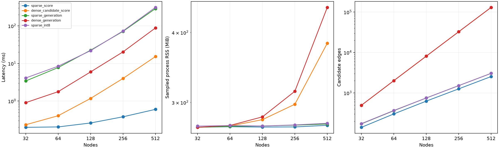
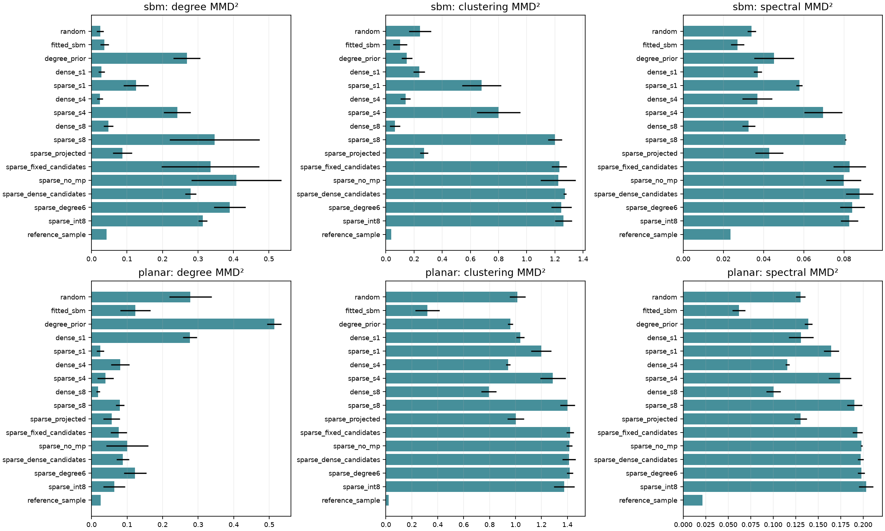
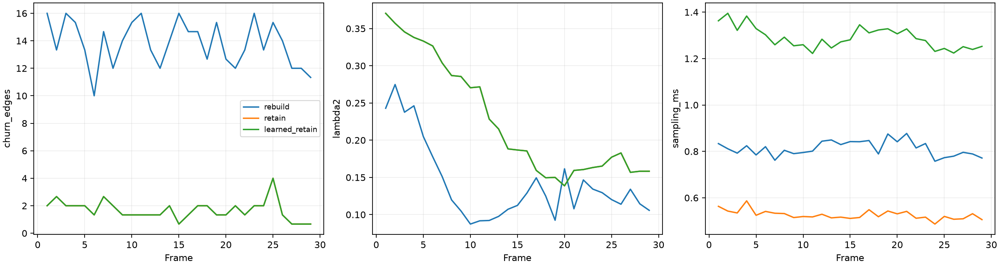

# Comparing Dense and Sparse Graph Generation

This PyTorch project compares dense and sparse models for generating connected
graphs under an edge budget, with optional degree limits. It measures graph
quality, memory use and generation time. Saved models and recorded results
are included.

## Results

The main study trained nine models across three random seeds and evaluated
2,880 generated graphs. It used conditioned stochastic block models (SBMs) and
planar graphs, with 32 nodes and 64 edges per dataset graph.

All evaluated outputs met the requested connectivity, edge-budget and degree
constraints.

### Runtime and memory

At 512 nodes, with one CPU thread, four generation steps and a batch size of one:

| Measurement | Dense | Sparse |
|---|---:|---:|
| Median full generation time (ms) | 88.22 | 288.89 |
| Process memory, sampled RSS (MiB) | 443.64 | 274.47 |

Sparse generation used **38.1% less memory**, but took **3.27 times longer**.

Scoring alone tells a different story. With the same sparse model weights,
scoring sparse candidates was **25.4 times faster** than scoring every possible
pair. Enforcing constraints took most of the full generation time.



### Graph quality

At matched step counts (1, 4 or 8), standard sparse variants matched clustering
statistics less well than dense ones in both graph families. Other pairings
can differ: on planar data, `sparse_projected` had slightly lower clustering
MMD² than `dense_s1` (1.0024 versus 1.0373).

**None of the evaluated outputs was planar.** Planarity was checked, not
enforced. Meeting the requested constraints did not guarantee it.

Lower MMD² means a closer match to the test distribution:



All models were trained and tested for quality at 32 nodes. Larger graphs
were used only for timing and memory tests.

### Moving agents

For moving agents, the study compares rebuilding connections each frame,
keeping and repairing the previous graph, and adding learned scores to that
retention rule. The figure tracks connection changes, algebraic connectivity
and generation time.



See [results](docs/RESULTS.md) and [methods](docs/METHODS.md) for details.

## Reproduce or inspect

Use Python 3.12 from the repository root:

```bash
python3.12 -m venv .venv
source .venv/bin/activate
python -m pip install -r requirements.txt
python -m pip install --no-deps --no-build-isolation -e .
```

Generate graphs with the saved sparse model: 32 nodes, 64 edges and a maximum
degree of six.

```bash
python -m frugal_graphs.research sample --nodes 32 --budget 64 --degree-cap 6 --output generated/demo
```

Restore the recorded results, recompute metrics and check constraints:

```bash
python -m frugal_graphs.research restore --output generated/recorded
python -m frugal_graphs.research verify --output generated/recorded
```

Run the tests and a short experiment:

```bash
python -m pytest -q
python -m frugal_graphs.research run --smoke --output generated/smoke
python -m frugal_graphs.research verify --output generated/smoke
```

Full experiment settings and seeds are in [configs/research.json](configs/research.json).

## License

[MIT License](LICENSE). Copyright © 2026 Alexandre Autran.
